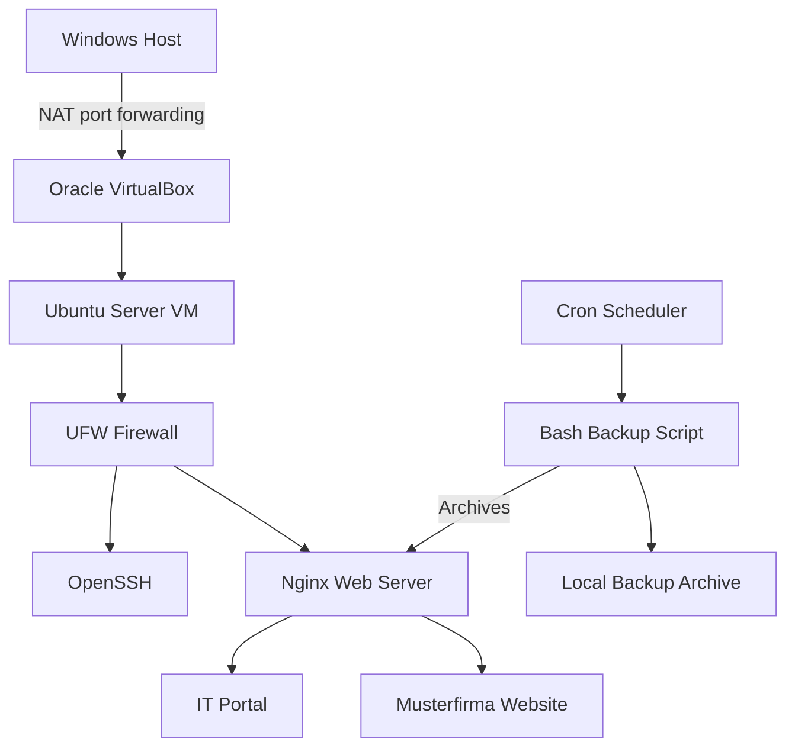

# Project 2: Linux Web Server Infrastructure


## Overview

This project expands the Linux company environment from **Project 1** into a small web-server infrastructure for a fictional company, **Musterfirma GmbH**.

The goal was to configure an Ubuntu Server virtual machine that can host multiple websites, provide HTTPS access, restrict incoming network traffic, support secure remote administration, and create scheduled backups.

The server runs in Oracle VirtualBox on a Windows host. The project focuses on practical Linux system administration and the configuration of services commonly used in small business environments.

## Business Scenario

Musterfirma GmbH needs a server to host its company website and an internal IT portal. As the system administrator, I was responsible for setting up the web services and applying basic security and backup measures.

The infrastructure needed to provide:

- Web hosting for more than one website.
- Encrypted HTTPS connections for the IT portal.
- Firewall rules that allow only required incoming services.
- Secure remote administration over SSH.
- A repeatable backup process for website files and Nginx configuration.
- A basic recovery test to check that archived files can be restored.

## Infrastructure Architecture



### VirtualBox port forwarding

The following host-to-guest port mappings were configured:

| Windows host port | Ubuntu guest port | Purpose |
|---:|---:|---|
| 8080 | 80 | HTTP |
| 8443 | 443 | HTTPS |
| 2222 | 22 | SSH |

For example, the IT portal can be reached from the Windows host at:

- HTTP: `http://it-portal.local:8080`
- HTTPS: `https://it-portal.local:8443`

The local hostname `it-portal.local` was mapped to `127.0.0.1` in the Windows hosts file. This is local name resolution for the lab, not a production DNS service.

## Technologies Used

| Technology | Purpose |
|---|---|
| Ubuntu Server | Server operating system |
| Oracle VirtualBox | Virtual machine environment |
| Nginx | Web server and virtual hosting |
| OpenSSL | Self-signed TLS certificate generation |
| UFW | Host firewall management |
| OpenSSH | Secure remote administration |
| Bash | Backup automation |
| Cron | Scheduled execution |
| `tar` | Backup archive creation |

## Implementation

### 1. Multi-site hosting with Nginx

Nginx was configured to serve separate websites from separate document roots.

The IT portal uses:

- Web root: `/var/www/it-portal`
- Nginx site configuration: `/etc/nginx/sites-available/it-portal`
- Enabled site link: `/etc/nginx/sites-enabled/it-portal`
- Hostname: `it-portal.local`

The configuration uses a separate Nginx server block and a `try_files` rule to serve existing files or return a 404 response when a requested file is not found.

### 2. HTTPS and TLS

OpenSSL was used to generate a self-signed certificate for `it-portal.local`.

Nginx was configured to listen for HTTPS traffic on guest port `443`. HTTP requests for the IT portal are redirected to HTTPS.

The certificate is self-signed, so a browser warning is expected because the certificate is not issued by a certificate authority trusted by the browser. This is suitable for a controlled lab environment, not a public production website.

The certificate's private key is stored on the server and protected with restrictive file permissions. **Private keys must never be committed to GitHub.**

### 3. Firewall with UFW

UFW was configured with a default-deny incoming policy and a default-allow outgoing policy.

The required incoming services were allowed:

| Service | Guest port | Purpose |
|---|---:|---|
| SSH | 22/TCP | Remote administration |
| HTTP | 80/TCP | Web traffic and HTTPS redirect |
| HTTPS | 443/TCP | Encrypted web traffic |

The firewall rules apply to the Ubuntu guest ports. VirtualBox forwards the selected Windows host ports to those guest ports.

### 4. SSH hardening

SSH provides remote command-line access to the Ubuntu Server VM.

The server was configured to:

- Allow public-key authentication.
- Disable SSH password authentication.
- Keep root remote login restricted.
- Use an Ed25519 SSH key pair generated on the Windows host.

The private key remains on the Windows host. Only the public key is installed in the Ubuntu user's `~/.ssh/authorized_keys` file.

### 5. Backup script

A Bash script was created at:

`/usr/local/bin/musterfirma-backup.sh`

The script creates a timestamped compressed archive containing:

- `/var/www` — website files.
- `/etc/nginx` — Nginx configuration and related files.

Backups are stored in:

`/var/backups/musterfirma`

The backup directory is owned by root and restricted so ordinary users cannot access its contents.

The archive also contains the Nginx TLS private key because the key is stored under `/etc/nginx`. Therefore, backup archives are sensitive and must remain protected. They must not be uploaded to the repository.

### 6. Recovery test

A backup archive was extracted into a temporary directory:

`/tmp/musterfirma-restore-test`

The restored website directory was inspected to confirm that the archived website files were present.

This verified that the archive could be read and its contents extracted without overwriting the live website.

### 7. Scheduled backups and logging

A Cron job was configured in:

`/etc/cron.d/musterfirma-backup`

Schedule:

```cron
0 2 * * * root /usr/local/bin/musterfirma-backup.sh >> /var/log/musterfirma-backup.log 2>&1
```

This schedules the backup script to run daily at 02:00 server time. Standard output and error output are appended to:

`/var/log/musterfirma-backup.log`

The script was also run manually with root privileges and its output was successfully written to the log. The scheduled job is configured; an automatic run at 02:00 has not yet been independently observed.

## Validation and Testing

The following checks were performed during implementation:

| Area | Validation |
|---|---|
| Nginx | Configuration tested and service reloaded |
| HTTP | Website accessed through the forwarded host port |
| HTTPS | IT portal accessed over HTTPS |
| TLS | Self-signed certificate used by Nginx |
| UFW | HTTP and HTTPS access tested after enabling firewall |
| SSH | New SSH session successfully authenticated using the key |
| Backup | Script created a timestamped `.tar.gz` archive |
| Archive | Archive contents listed and inspected |
| Recovery | Archive extracted into a temporary directory |
| Logging | Backup output successfully written to the log file |
| Cron | Daily 02:00 schedule configured and Cron service enabled |

## Troubleshooting Notes

A few practical issues were encountered and resolved during the project:

- **Nginx configuration errors:** Checked the configuration and corrected certificate and key file references before reloading Nginx.
- **HTTPS browser warning:** Confirmed that the warning was expected because the lab uses a self-signed certificate.
- **SSH key setup:** Corrected the public-key installation path and verified key-based login from a new PowerShell session.
- **Firewall access:** Allowed the Ubuntu guest service ports required by the VirtualBox forwarding rules.
- **Backup directory permissions:** Used root privileges to access the protected backup directory.
- **Log redirection permissions:** Learned that shell redirection is performed by the current shell. Running the command through `sudo` alone does not make the shell's redirection privileged, so the logging test was run with a root shell.

These troubleshooting steps helped reinforce the relationship between Linux permissions, services, network forwarding, and administrative privileges.

## Security Considerations and Limitations

- The TLS certificate is self-signed and is not automatically trusted by browsers.
- SSH password authentication is disabled, so access depends on possession of an authorized private key.
- UFW restricts incoming traffic to the services required by this lab.
- Backup archives contain sensitive server configuration, including the TLS private key, and must be protected.
- Backups are stored on the same virtual machine. They do not protect against loss of the VM or its virtual disk.
- This is a learning environment and has not been configured or tested as a production hosting platform.

## Possible Future Improvements

- Store encrypted backups on a separate machine or off-site location.
- Add a backup retention policy.
- Automate restore verification.
- Use a trusted certificate for a public domain.
- Add service and disk monitoring.
- Document more failure and recovery scenarios.

## Repository Structure

```text
Project-2-Web-Server-Infrastructure/
├── README.md
├── screenshots/
├── diagrams/
├── configurations/
└── backup/
```

Only sanitized configuration examples and documentation should be stored in this repository. Do not upload private keys, passwords, SSH private-key files, or actual backup archives.

## Skills Practiced

- Linux server administration
- Nginx configuration and virtual hosting
- HTTP and HTTPS fundamentals
- TLS certificate generation
- Linux firewall management
- SSH key-based authentication
- Linux file permissions and privilege management
- Bash scripting
- Cron scheduling and log management
- Backup and recovery testing
- Troubleshooting and technical documentation

---

**Project 2: Linux Web Server Infrastructure**  
**Environment:** Ubuntu Server on Oracle VirtualBox  
**Company scenario:** Musterfirma GmbH
